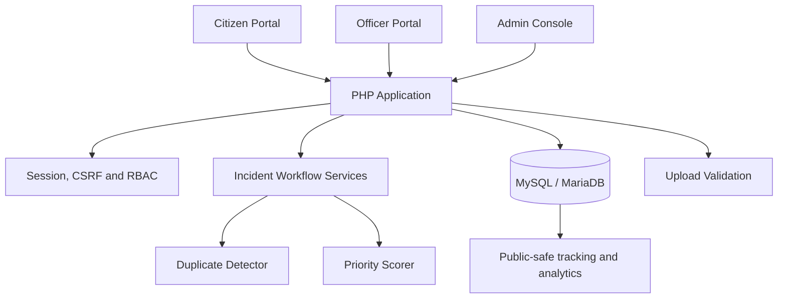

<div align="center">

# CivicShield

### Privacy-Preserving Civic Incident Intelligence Platform

*A role-based civic reporting and incident-management system that helps citizens report local issues, lets municipal teams triage and resolve them, and limits public exposure of reporter information and precise locations.*


**Web Technology Open Elective Project (OEP) · Semester 5 · Academic Year 2026–27**  
Sarvajanik College of Engineering & Technology (SCET), Sarvajanik University · Surat, Gujarat, India

</div>

---

## Table of Contents

1. [Overview](#1-overview)
2. [Problem and Goals](#2-problem-and-goals)
3. [Core Features](#3-core-features)
4. [Architecture](#4-architecture)
5. [End-to-End Workflow](#5-end-to-end-workflow)
6. [Privacy and Security](#6-privacy-and-security)
7. [Role Capabilities](#7-role-capabilities)
8. [Incident Lifecycle](#8-incident-lifecycle)
9. [Duplicate Detection](#9-duplicate-detection)
10. [Priority Scoring](#10-priority-scoring)
11. [Technology Stack](#11-technology-stack)
12. [Repository Structure](#12-repository-structure)
13. [Requirements](#13-requirements)
14. [Local Installation](#14-local-installation)
15. [Database Setup](#15-database-setup)
16. [Run the Application](#16-run-the-application)
17. [API Reference](#17-api-reference)
18. [Tests and Verification](#18-tests-and-verification)
19. [Demo Walkthrough](#19-demo-walkthrough)
20. [Known Limitations](#20-known-limitations)
21. [Documentation Index](#21-documentation-index)
22. [Academic Information](#22-academic-information)
23. [Disclaimer](#23-disclaimer)
24. [License](#24-license)

---

## 1. Overview

CivicShield is a PHP and MySQL/MariaDB web application for reporting, consolidating, assigning and resolving civic incidents. It separates individual citizen reports from canonical incidents so multiple reports can contribute to one municipal case while preserving a traceable workflow.

The system includes three application roles:

- **Citizen:** submits an incident report and can use a private tracking token to check its status.
- **Field officer:** views assigned work, records field progress and submits resolution updates.
- **Administrator:** reviews duplicate candidates, manages the incident queue and assignments, verifies closure and reviews operational analytics.

The application is an academic prototype. Its privacy mechanisms reduce exposure in application views and public endpoints, but they do not guarantee absolute anonymity or formal differential privacy.

## 2. Problem and Goals

Civic reporting platforms need enough detail to route and resolve real problems, but broad access to reporters' identity, contact details or precise location can create privacy risks. CivicShield aims to provide useful municipal workflow data while minimizing public exposure of sensitive intake information.

The project goals are to:

1. Provide citizen-facing incident reporting and status tracking.
2. Consolidate corroborating reports through a human-reviewed duplicate workflow.
3. Prioritize operational work with a transparent heuristic.
4. Assign incidents to officers and record lifecycle history.
5. Provide administrator analytics with obfuscated map coordinates.
6. Apply defensive web controls across authentication, forms, database access and file uploads.

## 3. Core Features

| Feature | Implementation |
|---|---|
| Role-based workflows | Citizen, officer and administrator pages with server-side authorization |
| Civic incident intake | Category, description, severity, location and optional attachment/contact consent |
| Private report tracking | Random tracking token; database stores a SHA-256 digest rather than the raw token |
| Duplicate candidates | Spatial, category, text and time signals; administrator confirms or marks distinct |
| Distinct-report promotion | A report marked distinct can be promoted to its own canonical incident through the current workflow |
| Priority indicator | Transparent rule-based score used as decision support, not an ML prediction |
| Work assignment | Administrator dispatches incidents to officers with instructions |
| Resolution workflow | Officers submit field updates/evidence; authorized administrator verifies closure |
| Analytics | Operational KPIs, charts and map data using obfuscated coordinates |
| Operational traceability | Status history and audit records |
| Upload handling | Type/size checks and upload storage protections |

## 4. Architecture

CivicShield uses a server-rendered PHP architecture; it does not require a Node/React frontend build step.



Major implementation areas:
- `config/`: application and database configuration.
- `core/`: session, database, incident lifecycle, duplicate detection, priority scoring, uploads, analytics and response helpers.
- `auth/`, `citizen/`, `officer/`, `admin/`: role-specific workflows.
- `api/v1/`: minimal health and public report tracking endpoints.
- `database/`: schema, demo seed data and migrations.
- `tests/`: CLI regression scripts.

See [Architecture & Privacy Model](docs/architecture.md) for the ERD and deeper technical design.

## 5. End-to-End Workflow

1. A citizen submits an incident with descriptive and location details.
2. The system stores the report and issues a tracking token to the reporter.
3. Candidate matches can be queued for administrative duplicate review.
4. The administrator confirms duplicate associations or marks the report distinct.
5. A canonical incident is assigned to a suitable field officer.
6. The officer updates status and adds field notes/evidence.
7. The administrator reviews resolution and closes or otherwise updates the incident through allowed transitions.
8. Public tracking exposes lifecycle information without returning citizen contact details or raw intake coordinates.

## 6. Privacy and Security

| Control | Purpose |
|---|---|
| Separated contact data | Optional contact information is stored separately from public incident summaries |
| Tracking token hashing | Database stores SHA-256 token digests |
| Location obfuscation | Map-oriented payloads use fuzzed/obfuscated coordinates |
| Prepared DB operations | PDO and parameterized statements mitigate SQL injection risk |
| CSRF checks | State-changing requests validate anti-CSRF tokens |
| Session protections | Session configuration, regeneration and authentication throttling |
| Redirect validation | Redirect targets are restricted to safe local/same-host destinations |
| Upload controls | Type/size validation, generated storage names, upload directory protection |
| Minimal public API | Health response omits raw diagnostics; tracking endpoint uses POST |

**Privacy caveat:** coordinate fuzzing is not a formal epsilon-differential-privacy guarantee. Any non-demo deployment needs a threat-model review, secure infrastructure and additional testing.

## 7. Role Capabilities

| Capability | Guest / Citizen | Officer | Administrator |
|---|---|---|---|
| Submit / track a report | Submit/track as permitted | — | — |
| Review duplicate candidates | — | — | Yes |
| Assign/reassign incidents | — | — | Yes |
| Update assigned field work | — | Assigned work only | Oversight |
| Verify / close incidents | — | Submit field outcome | Yes |
| View operational analytics | — | — | Yes |

Server-side guards are authoritative. Hiding a menu item alone is not access control.

## 8. Incident Lifecycle

The application uses a guarded lifecycle. Current workflows include states such as `reported`, `triaged`, `assigned`, `in_progress`, `resolution_submitted`, `resolved`, `closed`, `rejected`, and report-level states for duplicate/standalone handling.

Allowed transitions are enforced by `core/IncidentManager.php`; do not treat this list as permission to make arbitrary state jumps. Check the implementation before changing lifecycle rules.

## 9. Duplicate Detection

The duplicate detector combines multiple signals rather than relying on distance alone:

| Signal | Documented weight |
|---|---:|
| Spatial proximity | 40% |
| Category agreement | 30% |
| Text similarity | 20% |
| Time proximity | 10% |

Candidate results support administrator review. A high score is not proof of identity, and location alone must not cause automatic destructive merging. See [Matching Algorithm](docs/matching-algorithm.md).

## 10. Priority Scoring

The priority engine is a transparent heuristic. The documented design combines submitted severity (35%), distinct report count (25%), elapsed time (20%), and category/SLA urgency (20%), bounded to a 0–100 score. It is decision support, not an AI model or a definitive real-world risk judgment.

Implementation source: `core/PriorityScorer.php`. See [Priority Engine](docs/priority-engine.md).

## 11. Technology Stack

| Layer | Technology |
|---|---|
| Server | Native PHP 8.x |
| Database | MySQL 8 / MariaDB through PDO |
| UI | HTML5, CSS3, Bootstrap 5.3, Bootstrap Icons |
| Browser logic | JavaScript ES6+, jQuery, Fetch/AJAX |
| Maps | Leaflet.js and OpenStreetMap |
| Local environment | XAMPP/Apache on Windows or compatible PHP/MySQL environment |
| Testing | PHP CLI regression scripts |

## 12. Repository Structure

```text
CivicShield/
├── .env.example
├── README.md
├── index.php / track.php
├── auth/                  # login, registration, logout
├── citizen/               # dashboard, reporting and receipt
├── officer/               # assigned queue and incident work
├── admin/                 # incidents, duplicate review, analytics
├── api/v1/                # health.php and track.php
├── config/                # application and database config
├── core/                  # sessions, incidents, scoring, uploads, analytics
├── includes/              # shared UI and authorization helpers
├── database/              # schema, seed data and migrations
├── docs/                  # design, setup, security and evaluation docs
├── tests/                 # PHP CLI regression suites
├── assets/                # CSS and JavaScript
└── uploads/               # guarded upload storage
```

## 13. Requirements

- PHP 8.1+ (PHP 8.2 used in the recorded local test environment).
- MySQL 8 / MariaDB.
- XAMPP on Windows, or a compatible Apache/PHP/MySQL setup.
- Required PHP extensions, including PDO MySQL and fileinfo; GD may be used by image-processing paths.
- Modern web browser. Git is optional.

## 14. Local Installation

### Step 1 — Get the code

If you already have the project directory, skip cloning. Otherwise:

```powershell
git clone https://github.com/NiravHub/CivicShield-Privacy-Preserving-Civic-Incident-Intelligence-Platform.git
cd CivicShield-Privacy-Preserving-Civic-Incident-Intelligence-Platform
```

### Step 2 — Configure environment

```powershell
Copy-Item .env.example .env
```

Edit `.env`. For a directory served as `http://localhost/OEP`, set the corresponding base URL and DB credentials. See [Deployment Guide](docs/deployment.md). Never commit `.env`.

### Step 3 — Set up database

Start MySQL from XAMPP, then from the project root:

```powershell
& "C:\xampp\mysql\bin\mysql.exe" -u root -e "source database/schema.sql"
& "C:\xampp\mysql\bin\mysql.exe" -u root -e "source database/seed.sql"
```

The schema creates the configured database and tables. Seed data is for a disposable local demonstration only.

## 15. Database Setup

See [Database Design](docs/database-design.md) for entities, relationships and migration guidance. For a fresh database use the current `schema.sql` followed by `seed.sql`; do not blindly apply historical migrations on top of a fresh schema.

## 16. Run the Application

### Option A — XAMPP Apache

Place the project at `C:\xampp\htdocs\OEP` (or create a directory junction), set `APP_URL=http://localhost/OEP`, then open `http://localhost/OEP/`.

### Option B — PHP development server

From the project root:

```powershell
php -S localhost:8000
```

Set `APP_URL=http://localhost:8000` and open `http://localhost:8000/`. The built-in server is for local development, not public production hosting.

Health check: `http://localhost/OEP/api/v1/health.php` (adjust base URL if using port 8000).

## 17. API Reference

- `GET /api/v1/health.php`: minimal health state and timestamp; raw diagnostics are not exposed publicly.
- `POST /api/v1/track.php`: status lookup using the token in the request body.
- `GET /api/v1/track.php`: `405 Method Not Allowed`.

See [API Reference](docs/api.md).

## 18. Tests and Verification

Run from the repository root; some scripts require the configured database and expected test/demo data:

```powershell
php .\tests\test_phase6.php
php .\tests\test_phase7.php
php .\tests\test_phase8.php
php .\tests\test_phase9.php
php .\tests\test_phase10.php
php .\tests\test_login_rate_limit.php
php .\tests\test_distinct_report_promotion.php
php .\tests\test_resolution_evidence_workflow.php
php .\tests\test_resolution_guard.php
```

Key-file syntax checks:

```powershell
php -l .\core\Session.php
php -l .\api\v1\health.php
php -l .\api\v1\track.php
php -l .\track.php
php -l .\auth\login.php
```

The recorded security report lists 67 passing checks across the Phase 6–10 suites at the time it was written. Additional suites were added later; do not assume all nine listed suites were rerun together unless you execute them. See [Testing Guide](docs/testing.md) and [Security Test Report](docs/security_test_report.md).

## 19. Demo Walkthrough

1. Sign in with a local seed account from `database/seed.sql`.
2. Submit a report as a citizen and keep the issued tracking token private.
3. Sign out and track the report.
4. Review duplicate candidates as administrator and confirm or mark distinct.
5. Assign an incident to a field officer.
6. Record field updates and submit resolution details/evidence.
7. Verify/close the incident as administrator and review status history.
8. Inspect analytics and verify public map output excludes raw coordinates and contact details.

See [Demo Guide](docs/demo_guide.md). Demo accounts and tracking tokens are public fixtures, not production credentials.

## 20. Known Limitations

- The home-page map includes seeded demonstration markers; do not assume it is a live database feed.
- Spatial fuzzing is a privacy aid, not formal differential privacy or complete anonymization.
- Some workflows require correct configuration and role-specific test data to demonstrate.
- Mapping and chart libraries may load from external CDNs.
- An academic prototype and passing tests do not substitute for a security audit or production assessment.

## 21. Documentation Index

| Document | Contents |
|---|---|
| [Architecture](docs/architecture.md) | Architecture, ERD, lifecycle, privacy boundaries and algorithm design |
| [Deployment](docs/deployment.md) | Environment, database initialization, serving and troubleshooting |
| [Database Design](docs/database-design.md) | Main tables, relationships and migration guidance |
| [API Reference](docs/api.md) | Health and public tracking endpoints |
| [Matching Algorithm](docs/matching-algorithm.md) | Duplicate scoring and human review |
| [Priority Engine](docs/priority-engine.md) | Priority heuristic and intended use |
| [Privacy Model](docs/privacy-model.md) | Location, contact/token protection and residual risks |
| [Security Notes](docs/security.md) | Current controls and deployment hardening |
| [Testing Guide](docs/testing.md) | CLI suites and manual smoke checks |
| [Demo Scenario](docs/demo-scenario.md) | Short citizen-to-admin-to-officer walkthrough |
| [Demo Guide](docs/demo_guide.md) | Detailed evaluator script and sample flow |
| [Requirements](docs/requirements.md) | Evidence-based functional requirements |
| [Requirements Audit](docs/requirements_audit.md) | Detailed checkpoint audit and documented gaps |
| [Project Audit](docs/project-audit.md) | Review scope and validation notes |
| [Security Test Report](docs/security_test_report.md) | Recorded automated and developer-reported manual results |

## 22. Academic Information

| Field | Value |
|---|---|
| Project | CivicShield — Privacy-Preserving Civic Incident Intelligence Platform |
| Type | Web Technology Open Elective Project (OEP) |
| Semester | 5 |
| Academic context | 2026–27 |
| Institution | Sarvajanik College of Engineering & Technology (SCET), Sarvajanik University |
| Location | Surat, Gujarat, India |

## 23. Disclaimer

CivicShield is an academic prototype for demonstration and learning. It is not an official municipal reporting channel, emergency service, or certified privacy system. Do not use it for real emergencies or store real citizen contact/location data without appropriate legal, security and operational review.

## 24. License

No `LICENSE` file was found in the inspected repository tree. Until the project includes an explicit license, reuse permission should not be assumed. Third-party services and libraries are subject to their own terms.
