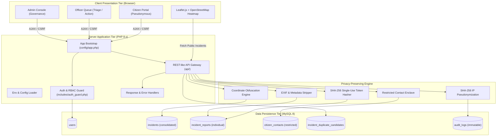
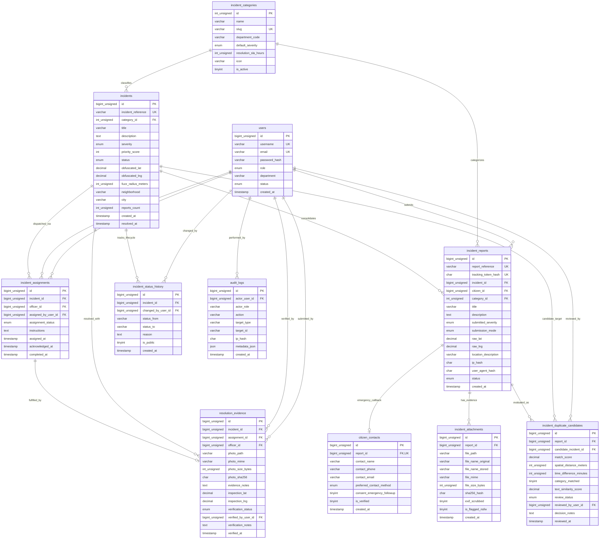
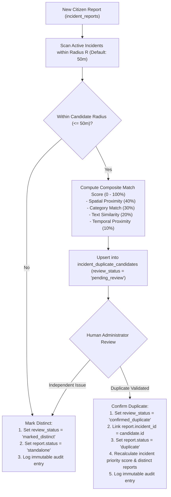
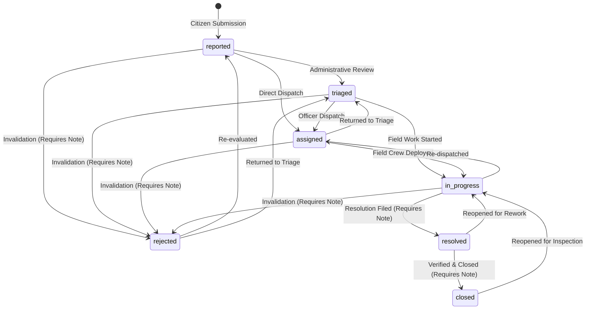
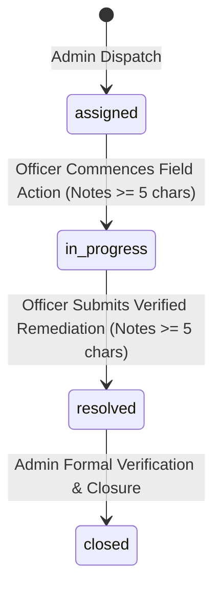

# CivicShield: System Architecture & Privacy Model

## 1. Project Overview
**CivicShield: Privacy-Preserving Civic Incident Intelligence Platform** is a Web Technology Open Elective Project designed to reconcile two conflicting priorities in civic tech:
1. **Public transparency & municipal accountability**: Providing civic agencies with actionable incident intelligence and citizen reports.
2. **Citizen anonymity & privacy preservation**: Protecting whistleblowers and citizens reporting civic hazards, corruption, or local infrastructure issues against retaliation, doxxing, or location profiling.

---

## 2. Technical Stack
- **Frontend Presentation:** HTML5, CSS3, Bootstrap 5.3, Bootstrap Icons
- **Client Scripting & Asynchronous Communication:** Vanilla JavaScript (ES6+), jQuery 3.7.1, Fetch API, AJAX, JSON
- **Mapping & Geospatial Intelligence:** Leaflet.js 1.9.4, OpenStreetMap (OSM) Tile API
- **Backend Core:** PHP 8.2+ (pure vanilla / native architecture, strictly framework-free)
- **Data Persistence:** MySQL 8.x / MariaDB accessed via PHP Data Objects (PDO) with prepared statements
- **Execution Environment:** Compatible with XAMPP (Apache + MariaDB) on Windows.

---

## 3. High-Level Architecture Diagram



---

## 4. Phase 2: Relational Database Architecture & Entity-Relationship Model

The CivicShield data tier is normalized to third normal form (3NF) and partitioned into security tiers to prevent correlation attacks while maintaining full relational integrity.

### 4.1. Entity-Relationship Diagram (ERD)



---

## 5. Table Responsibilities & Architectural Roles

| Table Name | Cardinality / Storage Tier | Responsibility |
| :--- | :--- | :--- |
| `users` | Core Identity & RBAC | Manages accounts across 3 roles (`citizen`, `officer`, `admin`). Password hashes generated with BCRYPT. For citizens, stores only user-chosen pseudonyms; personal identity is omitted. |
| `incident_categories` | Reference Taxonomy | Standardized municipal problem classifications mapped to municipal departments (e.g., SMC Roads, Drainage, Solid Waste) with SLA deadlines. |
| `incidents` | Public Consolidated Intelligence | The canonical public civic issue. Holds fuzz-perturbed public coordinates, composite priority score, consolidated status, and aggregated report count. |
| `incident_reports` | Raw Intake Ledger | Individual citizen submissions. Retains raw sensor coordinates in a restricted intake partition. Supports both pseudonymous and anonymous submissions. |
| `citizen_contacts` | Privacy Enclave | Strictly isolated table containing optional callback details. Never queried by public map feeds, APIs, or unauthenticated endpoints. |
| `incident_attachments` | File Evidence Metadata | Metadata and cryptographic content digests (SHA-256) of citizen photos. EXIF scrubbing flag recorded; image binaries reside securely on filesystem. |
| `incident_duplicate_candidates` | Dedup Match & Decision Audit | Holds algorithmically computed candidate matches with composite scores (0–100%) and logs the human verification decision before merging. |
| `incident_assignments` | Operational Work Orders | Tracks assignment of consolidated incidents from administrators to field officers, including instructions, acknowledgments, and timestamps. |
| `resolution_evidence` | Proof of Work & Verification | Contains officer-submitted completion photos, notes, and on-site verification GPS coordinates. Requires administrative approval before closing incidents. |
| `incident_status_history` | Audit Lifecycle Trail | Immutable state-machine transitions (`status_from` $\to$ `status_to`), logging the actor, timestamp, and justification. |
| `audit_logs` | Security & Administrative Log | Immutable system ledger recording administrative events, IP hashes, and metadata without recording citizen personal data. |

---

## 6. Privacy Separation & Security Architecture

### 6.1. Separation of Public Incidents and Citizen Intake
A critical vulnerability in civic applications is exposing whistleblower locations or contact records on public dashboards. CivicShield enforces structural isolation:
1. **Consolidated Public Records (`incidents`):** Accessible to the public and Leaflet.js map layers. Stores only obfuscated coordinates (`obfuscated_lat`, `obfuscated_lng`) fuzzed by $\approx 150m$, general neighborhood names, and aggregated counts.
2. **Individual Submissions (`incident_reports`):** Accessible only to system intake and authorized investigative staff.
3. **Contact Details (`citizen_contacts`):** Completely decoupled from both tables with 1-to-1 foreign key back to the individual report. Only queried when an emergency follow-up is legally required and consented to.

### 6.2. Single-Use Tracking Token Hashes
When an anonymous citizen submits an incident, they do not create an account. Instead, the application generates a cryptographically random 32-character tracking token (e.g., `cstk_vesu_waterleak_7a9f2b1c4e6d`).
- The database stores **only** the SHA-256 hash (`tracking_token_hash`).
- When the citizen requests a status update, their supplied token is hashed client/server side and matched via constant-time lookups.
- Even if database dumps are compromised, raw tokens cannot be reversed.

### 6.3. Anti-Doxxing IP and Metadata Hashing
Audit logs and reports store `ip_hash` (a salted `SHA-256` digest). This enables rate-limiting, DDoS prevention, and automated fraud detection without retaining identifiable IP logs.

---

## 7. Duplicate Reporting & Consolidation Model (Phase 6)

Multiple citizens frequently report the same civic problem (e.g., an arterial road pothole or major water line burst). Merging reports incorrectly creates blind spots, while failing to consolidate fragments municipal dispatch resources.



### 7.1. Duplicate Candidate Scoring Formula
The composite duplicate match score ($S_{\text{duplicate}} \in [0, 100]$) is computed using four multi-dimensional metrics:

$$S_{\text{duplicate}} = 0.40 \cdot S_{\text{spatial}} + 0.30 \cdot S_{\text{category}} + 0.20 \cdot S_{\text{text}} + 0.10 \cdot S_{\text{time}}$$

Where:
1. **Spatial Proximity ($S_{\text{spatial}}$, 40% weight):**
   Computed using the Great-Circle Haversine formula over WGS84 coordinates against candidate incident centroids and linked ground points:
   $$d = 2 R_{\text{earth}} \arcsin\left(\sqrt{\sin^2\left(\frac{\Delta \phi}{2}\right) + \cos(\phi_1)\cos(\phi_2)\sin^2\left(\frac{\Delta \lambda}{2}\right)}\right)$$
   Where $R_{\text{earth}} = 6,371,000\text{ m}$. Within the candidate radius ($R = 50\text{m}$, configurable via `DUPLICATE_CANDIDATE_RADIUS_METERS`):
   $$S_{\text{spatial}} = 100 \cdot \max\left(0, 1 - \frac{d}{R}\right)$$
   *Gating rule:* Incidents with $d > R$ do not qualify as geographic candidates and receive zero candidate linkage.
2. **Category Match ($S_{\text{category}}$, 30% weight):**
   $$S_{\text{category}} = \begin{cases} 100.0 & \text{if } \text{category}_{\text{report}} = \text{category}_{\text{incident}} \\ 0.0 & \text{otherwise} \end{cases}$$
3. **Textual Similarity ($S_{\text{text}}$, 20% weight):**
   Evaluated over lowercase, punctuation-normalized titles and descriptions using a blended metric:
   $$S_{\text{text}} = 0.60 \cdot \text{Jaccard}_{\text{tokens}} + 0.40 \cdot \text{Similarity}_{\text{char}}$$
   Where $\text{Jaccard}_{\text{tokens}} = \frac{|T_1 \cap T_2|}{|T_1 \cup T_2|} \times 100$ and $\text{Similarity}_{\text{char}}$ is character-level longest common subsequence overlap.
4. **Temporal Proximity ($S_{\text{time}}$, 10% weight):**
   Calculated based on time elapsed $\Delta t$ between incident creation and report filing:
   - $\Delta t \le 2\text{ hours} \implies 100.0\%$
   - $2\text{h} < \Delta t \le 24\text{ hours} \implies \text{linear decay from } 100\% \text{ to } 70\%$
   - $24\text{h} < \Delta t \le 7\text{ days} \implies \text{linear decay from } 70\% \text{ to } 30\%$
   - $7\text{d} < \Delta t \le 14\text{ days} \implies \text{linear decay from } 30\% \text{ to } 0\%$
   - $\Delta t > 14\text{ days} \implies 0.0\%$

### 7.2. Incident Priority Scoring Formula
Incident priority is a transparent, rule-based decision-support indicator ($P \in [0, 100]$):

$$P = \min\left(100, \max\left(0, 0.35 \cdot S_{\text{sev}} + 0.25 \cdot S_{\text{rep}} + 0.20 \cdot S_{\text{time}} + 0.20 \cdot S_{\text{sla}}\right)\right)$$

Where:
- **Submitted Severity ($S_{\text{sev}}$, 35% weight):** `critical` = 100, `high` = 75, `medium` = 50, `low` = 25.
- **Report Volume ($S_{\text{rep}}$, 25% weight):** Strictly counts `COUNT(DISTINCT id)` independent citizen reports linked to the incident:
  - 1 report: 20
  - 2 reports: 45
  - 3 reports: 70
  - 4 reports: 85
  - 5+ reports: $\min(100, 85 + (N - 4) \times 5)$
- **Elapsed Time ($S_{\text{time}}$, 20% weight):** Hours since incident opened:
  - $\le 6\text{h}$: 20
  - $\le 24\text{h}$: 40
  - $\le 48\text{h}$: 65
  - $\le 72\text{h}$: 85
  - $> 72\text{h}$: 100
- **Category Urgency ($S_{\text{sla}}$, 20% weight):** Based on `incident_categories.resolution_sla_hours`:
  - $\text{SLA} \le 12\text{h}$ (Electrical/Emergency hazards): 100
  - $\text{SLA} \le 24\text{h}$ (Water/Drainage/Solid Waste): 75
  - $\text{SLA} \le 36\text{h}$ (Stray Animal hazards): 50
  - $\text{SLA} > 36\text{h}$ (Roads/Potholes/Civil repairs): 35

> [!NOTE]
> **Heuristic Integrity Disclosure:** This priority score is a deterministic, rule-based triage heuristic designed solely for administrative decision support. It is **not** an AI/ML black-box model and does not claim to objectively determine real-world danger.

### 7.3. Known System Limitations
1. **GPS Sensor Inaccuracy / Multipath Jitter:** Citizen smartphones in dense urban high-rise corridors (e.g., Vesu, Surat) may experience 10–30m GPS jitter. Setting the candidate radius to 50m balances recall without flooding the triage queue.
2. **Multilingual Lexical Variation:** Citizen descriptions submitted in Gujarati, Hindi, or transliterated Gujarati-English may exhibit lower token Jaccard similarity even if describing identical incidents. The 30% category weight and 40% spatial weight safeguard match detection.
3. **Centroid Obfuscation:** While public incident centroids are differentially fuzzed ($\approx 150\text{m}$), duplicate detection cross-references the restricted ground coordinates of linked reports where available to preserve high spatial fidelity during intake.

**Key Architectural Rule:** Proximity alone **never** triggers an automatic destructive merge. Every duplicate association is formally preserved in `incident_duplicate_candidates` with an explicit audit trail (`reviewed_by_user_id`, `decision_notes`, `reviewed_at`).

---

## 8. Role-Based Access Control (RBAC) Matrix

| Capability | Guest / Public | Citizen (Pseudonym) | Officer | Admin |
| :--- | :---: | :---: | :---: | :---: |
| View Public Heatmap & Incidents | Yes | Yes | Yes | Yes |
| Lookup Incident via Tracking Token | Yes | Yes | Yes | Yes |
| Submit Incident Report | Yes (Anon) | Yes (Pseudonym) | No | No |
| View Own Submissions | Via Token | Yes | No | Yes |
| Access Restricted Citizen Contacts | No | No | Verified Emergencies | Yes |
| Review Duplicate Candidates | No | No | Assigned Dept | Yes |
| Triage & Assign Incidents | No | No | No | Yes |
| Update Status & Upload Evidence | No | No | Yes | Yes |
| Verify Evidence & Close Incidents | No | No | No | Yes |
| Access Immutable Audit Trail | No | No | No | Yes |

---

## 9. Reproducible Local Setup & Execution Guide

### 9.1. Database Initialization Sequence
The database scripts must be executed in strict dependency order:
1. `database/schema.sql` (Creates `civicshield_db`, tables, constraints, foreign keys, and indexes)
2. `database/seed.sql` (Populates Surat demonstration data with valid BCRYPT hashes)

### 9.2. Executing via XAMPP MySQL CLI
```powershell
# Step 1: Import Schema
& "C:\xampp\mysql\bin\mysql.exe" -u root -e "source database/schema.sql"

# Step 2: Import Seed Data
& "C:\xampp\mysql\bin\mysql.exe" -u root -e "source database/seed.sql"
```

### 9.3. Executing via phpMyAdmin
1. Open `http://localhost/phpmyadmin/`.
2. Click **Import** in the top navigation.
3. Select `database/schema.sql` and click **Go**.
4. Select `database/seed.sql` and click **Go**.

---

## 10. Phase 7: Admin Incident Operations & Resolution Workflow

### 10.1. Architectural Overview
Phase 7 delivers the municipal administration and operational governance engine for CivicShield, empowering municipal administrators to manage the complete lifecycle of civic incidents, coordinate cross-departmental officer dispatch, enforce state-machine integrity, and review resolution evidence while rigorously maintaining citizen privacy boundaries.

### 10.2. Core Components
1. **Incident Operations Ledger (`admin/incidents.php`):**
   - Paginated incident table with clamped bounds ($1 \le \text{page}$, $5 \le \text{per\_page} \le 50$).
   - Multi-field filtering by municipal status, incident category, minimum priority score, and creation date range.
   - Comprehensive multi-target search across incident references, issue titles, and linked citizen report references.
   - Real-time priority score progress indicators, status badges, severity tags, and active officer assignment details.
   - Inline modal shortcuts for instant officer dispatch and status transitions.

2. **Incident Dossier View (`admin/incident_detail.php`):**
   - Interactive Leaflet.js geospatial map displaying the obfuscated incident centroid and a approximately 150 m location-obfuscation radius circle (not a formal differential privacy guarantee).
   - Full 4-factor decision support priority breakdown (Severity, Corroboration, Civic Decay, Time Decay).
   - Consolidated citizen report history (references, submission modes, severities, timestamps).
   - Officer assignment ledger documenting work orders, department dispatches, and instructions.
   - Immutable status lifecycle audit trail documenting status transitions, actors, and remarks.

3. **Core Manager Service (`core/IncidentManager.php`):**
   - Centralizes state-machine validation, filtering, officer eligibility checks, dispatch, and lifecycle mutations.
   - Enforces nested-transaction-safe PDO operations with automatic rollbacks.
   - Triggers dynamic priority score recalculation upon every status change via `PriorityScorer`.

### 10.3. Validated State Machine Transitions
CivicShield enforces a municipal state-machine transition matrix. Disallowed jumps (such as directly jumping from `reported` to `closed`) are rejected:



| Current Status | Permitted Target Transitions | Required Validation Rules |
| :--- | :--- | :--- |
| `reported` | `triaged`, `assigned`, `rejected` | If transitioning to `assigned`, an eligible active officer is assigned. |
| `triaged` | `assigned`, `in_progress`, `rejected` | Rejection requires minimum 5-character justification note. |
| `assigned` | `in_progress`, `triaged`, `rejected` | Reassignment updates previous work order to `reassigned`. |
| `in_progress` | `resolved`, `assigned`, `rejected` | Transition to `resolved` requires minimum 5-character resolution note. Auto-completes active assignments. |
| `resolved` | `closed`, `in_progress` | Transition to `closed` requires minimum 5-character closure note. Updates `closed_at`. |
| `closed` | `in_progress` | Reopens incident for remedial work; resets `closed_at`. |
| `rejected` | `reported`, `triaged` | Transition requires justification note. |

### 10.4. Departmental Dispatch & Reassignment Rules
- **Eligibility Filter:** Only users with `role = 'officer'` and `status = 'active'` are returned by `IncidentManager::getActiveOfficers()` and accepted by `IncidentManager::assignIncident()`.
- **Reassignment Lifecycle:** When an incident with an existing non-completed assignment is reassigned, the existing assignment is updated to `assignment_status = 'reassigned'`, preserving full historical work order provenance.
- **Auto-Promotion:** Assigning an incident in `reported` or `triaged` status automatically transitions the incident status to `assigned` and logs the event in `incident_status_history`.
- **Composite Index:** Accelerated active assignment lookup via `idx_assignments_active (incident_id, assignment_status)` migration `002_phase7_assignment_index.sql`.

### 10.5. Privacy Enclave Boundaries
Under no circumstances are citizen phone numbers or email addresses retrieved from `citizen_contacts` or displayed on administrative operations pages. Raw tracking tokens are never stored or exposed; only SHA-256 hashes and public non-sequential identifiers (`incident_reference`, `report_reference`) are displayed.

---

## 11. Phase 8: Officer Portal & Field Operations

### 11.1. Architectural Overview
Phase 8 delivers the dedicated Field Officer Portal for CivicShield. It enables municipal field personnel to receive, triage, acknowledge, execute, and mark civic remediation work orders while strictly enforcing role-based boundaries, protecting citizen whistleblower anonymity, and maintaining an immutable operational audit trail.

### 11.2. Officer Routes and Access Control Matrix

| Endpoint | Role Guard | Capabilities & Constraints |
| :--- | :--- | :--- |
| `officer/index.php` | `requireAuth('officer')` | Field operations dashboard with real-time KPI metrics, immediate action work orders, and personal activity log. |
| `officer/incidents.php` | `requireAuth('officer')` | Paginated personal dispatch queue with multi-field filtering (status, category, priority, view mode) and safe search. |
| `officer/incident_detail.php?id=X` | `requireAuth('officer')` | Comprehensive incident work order dossier with Leaflet centroid map (configured coordinate-displacement radius circle), administrative instructions, linked pseudonymous reports, and operational status transition controls. Denies access (HTTP 403) to unassigned incidents. |

### 11.3. Role & Assignment Authorization Rules
1. **Officer Role Validation:** Officer endpoints strictly verify `Session::hasRole('officer')`. Unauthenticated users are redirected to login (`auth/login.php?redirect=...`). Citizens or administrators attempting direct URL access are returned HTTP 403 Forbidden.
2. **Assignment Ownership:** Officers are only authorized to view or mutate incidents that have an explicit assignment record in `incident_assignments` where `officer_id = :authenticated_officer_id`.
3. **Active Work Order Filtering:** An assignment is defined as active when `assignment_status NOT IN ('completed', 'cancelled', 'reassigned')`. Reassigned and completed work orders are segregated into the historical view (`view=history`).
4. **Admin Protection:** Field officers cannot access administrator triage, cannot reassign work orders to other officers, and cannot approve duplicate merges.

### 11.4. Officer-Authorized Status Transitions
CivicShield limits field officer state-machine transitions to authorized operational milestones:



| Current Status | Authorized Officer Target | Automatic Side Effects |
| :--- | :--- | :--- |
| `assigned` | `in_progress` | Updates `incident_assignments.assignment_status = 'in_progress'`, records `acknowledged_at = NOW()`, logs `incident_status_history` and `audit_logs` (`OFFICER_STATUS_UPDATE`). |
| `in_progress` | `resolved` | Updates `incident_assignments.assignment_status = 'completed'`, records `completed_at = NOW()`, sets `incidents.resolved_at = NOW()`, recalculates priority score via `PriorityScorer`. |

*Note:* Officers are **not** permitted to jump directly from `assigned` to `resolved`, cannot mark incidents `closed` or `rejected`, and cannot re-triage incidents.

### 11.5. Privacy & Whistleblower Protection
- **No Contact Enclave Leaks:** Field officers never receive data from `citizen_contacts`. Whistleblower phone numbers, email addresses, and true names are never exposed in officer views.
- **No Raw Token Exposure:** Single-use tracking tokens remain strictly protected as one-way SHA-256 hashes. Linked reports are referenced solely by municipal tracking references (`REP-SRT-2026-XXXX`).
- **Obfuscated Incident Coordinates:** Map views render obfuscated incident coordinates with the configured coordinate-displacement radius circle, helping field crews locate general hazards without displaying the original submitted coordinates.

### 11.6. Test Commands & Verification
```powershell
# Phase 8 Officer Portal & Field Operations Suite
& "C:\xampp\php\php.exe" tests/test_phase8.php

# Phase 7 Admin Operations Regression Suite
& "C:\xampp\php\php.exe" tests/test_phase7.php

# Phase 6 Duplicate Detection & Priority Scoring Regression Suite
& "C:\xampp\php\php.exe" tests/test_phase6.php
```

---

## 12. Phase 9: Civic Intelligence Dashboard & Analytics

### 12.1. Architectural Overview
Phase 9 delivers the administrative **Civic Intelligence Dashboard** (`admin/analytics.php`), providing municipal leadership with high-level operational telemetry, resolution velocity metrics, departmental workloads, priority stratification, and longitudinal trends while strictly maintaining citizen whistleblower anonymity through obfuscated map centroids (no contact enclave or raw intake GPS in analytics payloads).

### 12.2. Core Components
1. **Analytics Engine (`core/AnalyticsManager.php`):**
   - High-performance, read-only SQL aggregation service using parameterized queries.
   - Summarizes total incident volume, open queue, remediated/closed issues, and resolution clearance rate.
   - Computes empirical average resolution time ($\text{hours}$) strictly where verified resolution timestamps exist (`TIMESTAMPDIFF(SECOND, created_at, resolved_at) / 3600.0`).
   - Generates status breakdowns, category distributions, priority tier histograms, and daily intake/resolution timelines.
   - Provides safe date normalization with automatic inverted range swapping (`date_from > date_to`).

2. **Visualizations & Presentation (`admin/analytics.php`):**
   - **Longitudinal Trend Chart:** Dual-series line chart (Chart.js 4.4.2 UMD) contrasting daily citizen incident intake against municipal remediation velocity.
   - **Lifecycle Status Distribution:** Doughnut chart illustrating the composition of the active municipal queue.
   - **Departmental Category Breakdown:** Horizontal bar chart comparing incident frequency across municipal classifications.
   - **Priority Tier Stratification:** Heuristic bar chart displaying distribution across Low (0–39), Medium (40–59), High (60–79), and Critical (80–100) score buckets.
   - **Departmental Telemetry Table:** Department codes, incident counts, citizen corroboration volumes, and average priority scores.

3. **Privacy-Preserving Spatial Density Map:**
   - Interactive Leaflet.js aggregate cluster map rendering obfuscated centroids (`obfuscated_lat`, `obfuscated_lng`) and fuzz-radius circles (`fuzz_radius_meters`, typically 150m).
   - Color-coded severity pins without leaking raw GPS coordinates (`raw_lat`, `raw_lng`), contact enclave data (`citizen_contacts`), or private tracking tokens.
   - **Honesty note:** This is spatial obfuscation / fuzzing for presentation, not a formal differential-privacy (ε-DP) mechanism.

### 12.3. Filter Normalization & Query Optimization
- Filter criteria (`date_from`, `date_to`, `category_id`, `status`, `min_priority`, `priority_tier`, `search`) are validated and sanitized server-side.
- Inverted date inputs are swapped transparently (`date_from <= date_to`).
- Computations use database-level aggregations (`COUNT()`, `SUM(CASE ...)`, `AVG()`, `GROUP BY`) rather than hydrating raw records into PHP memory.
- Status filters and KPI groupings use the canonical enum: `reported`, `triaged`, `assigned`, `in_progress`, `resolved`, `closed`, `rejected` (statuses such as `verified` / `investigating` / `action_scheduled` are **not** part of the implemented schema).

### 12.4. Test Commands & Verification
```powershell
# Phase 9 Civic Intelligence & Analytics Suite
& "C:\xampp\php\php.exe" tests/test_phase9.php

# Phase 8 Officer Portal Regression Suite
& "C:\xampp\php\php.exe" tests/test_phase8.php

# Phase 7 Admin Operations Regression Suite
& "C:\xampp\php\php.exe" tests/test_phase7.php

# Phase 6 Duplicate Detection Regression Suite
& "C:\xampp\php\php.exe" tests/test_phase6.php

# Phase 10 Final Audit / Integration Suite
& "C:\xampp\php\php.exe" tests/test_phase10.php
```

---

## 13. Phase 10: Final Security Audit, Integration Consistency & Submission Readiness

### 13.1. Status Vocabulary Reconciliation
Live MySQL enum, `IncidentManager` transition matrices, admin/officer filters, and `AnalyticsManager::STATUS_METADATA` all use:

`reported` → `triaged` → `assigned` → `in_progress` → `resolved` → `closed` (with `rejected` as an invalidation path).

Earlier draft terminology mentioning `verified`, `investigating`, or `action_scheduled` as incident statuses is obsolete and must not be used in demos or reports.

### 13.2. Active Assignment Consistency
An assignment is **active** when `assignment_status NOT IN ('completed', 'cancelled', 'reassigned')`. Admin listing/detail/reassignment/completion paths and officer queue/auth paths share this definition so reassigned work orders never appear as the current active assignee.

### 13.3. Officer Privacy Boundary Hardening
`IncidentManager::getLinkedReports($id, $pdo, false)` omits restricted intake coordinates for officer dossiers. Admin triage may still inspect raw intake pins for duplicate review. Contact enclave rows remain unqueried in officer and analytics surfaces.

### 13.4. Analytics Resilience
If the Chart.js CDN is unreachable, analytics charts degrade to an inline notice while KPI cards, tables, and the Leaflet map continue to function from server-rendered data.

### 13.5. Security Audit & Verification Summary
1. **Authentication & RBAC:**
   - Enforced across 100% of protected directories (`admin/`, `officer/`, `citizen/`).
   - Unauthorized attempts return clean 403 Forbidden pages or JSON error envelopes.
   - Cross-role privilege escalation (e.g., officers accessing admin endpoints or another officer's incident work orders) is strictly prevented.
2. **Session Security:**
   - Session fixation mitigated via `Session::regenerate()` upon authentication.
   - Cookies configured with `HttpOnly`, `SameSite=Lax`, and dynamic `Secure` flag.
   - Session state completely cleared upon logout via `Session::destroy()`.
   - Open redirect attacks thwarted via `Session::sanitizeRedirect()`.
3. **Injection & Input Validation:**
   - 100% of SQL queries utilize PDO prepared statements with positional or named parameter bindings.
   - Context-aware `htmlspecialchars()` escaping applied on all user-supplied outputs.
   - Multi-layer file upload filtering: MIME verification via `finfo`, file extension whitelisting, randomized stored filenames, EXIF scrubbing via GD, and `.htaccess` script execution prevention.
4. **Location Obfuscation & Reporter Privacy:**
   - Citizen identity and contact records isolated in encrypted `citizen_contacts` enclave.
   - Public tracking API and analytics queries strictly omit joins to contact enclave.
   - Single-use tracking tokens stored exclusively as SHA-256 cryptographic digests.
   - Public and analytics maps render obfuscated centroids with configured coordinate-displacement radius circles.

### 13.6. Automated Regression & Test Coverage Matrix
All test suites run in the local PHP 8 + MariaDB XAMPP environment:

| Phase | Test Suite | Scope | Passed | Failed |
| :---: | :--- | :--- | :---: | :---: |
| **Phase 6** | `tests/test_phase6.php` | Candidate duplicate detection, spatial distance, and priority heuristics | 14 | 0 |
| **Phase 7** | `tests/test_phase7.php` | Admin incident management, work order dispatch, and status state machine | 14 | 0 |
| **Phase 8** | `tests/test_phase8.php` | Officer portal, work order queues, and role-boundary enforcement | 14 | 0 |
| **Phase 9** | `tests/test_phase9.php` | Civic intelligence aggregations, KPI telemetry, and privacy map payload | 12 | 0 |
| **Phase 10** | `tests/test_phase10.php` | End-to-end integration, security audit, CSRF, and session protection | 13 | 0 |
| **Total** | **Comprehensive Full Coverage** | **All System Workflows** | **67** | **0 (100%)** |


## Current Implementation Note — October 24, 2026

The versioned public tracking endpoint is implemented at `api/v1/track.php` and accepts POST requests; GET requests return `405 Method Not Allowed`. The public health endpoint at `api/v1/health.php` returns a minimal health status rather than raw database diagnostics. Login throttling is backed by the `login_rate_limits` table, as described in the database schema and `docs/requirements_audit.md`. These controls are not a guarantee of complete security. Coordinate fuzzing is a location-obfuscation mechanism, not formal differential privacy.
